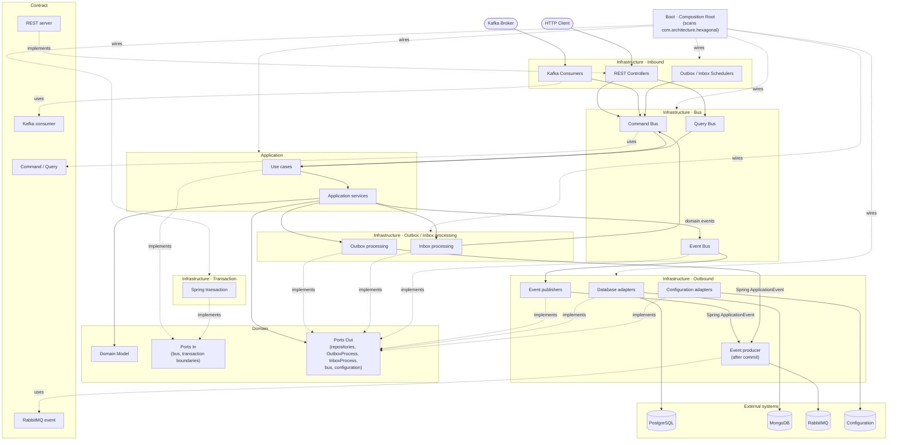

# Hexagonal Architecture - Java Project

This is a production-ready example project implementing **hexagonal architecture** (ports and adapters pattern) using **Java** and **Spring Boot** with **PostgreSQL**.

## 📋 Description

This repository is a practical implementation of **Hexagonal Architecture (Ports & Adapters)** in a **multi-module Maven** setup.

The goal is to keep the business core isolated from frameworks and infrastructure concerns, making the codebase easier to evolve, test, and maintain over time.

It is organized around these main Maven modules:

- **Domain**: business model, core rules, and ports, framework-agnostic
- **Application**: use cases and services that orchestrate the domain
- **Infrastructure**: inbound adapters (REST, Kafka, schedulers), outbound adapters (PostgreSQL, MongoDB, RabbitMQ, configuration), and the Outbox/Inbox processing components
- **Contract**: OpenAPI and AsyncAPI contracts, plus the CQRS bus contracts
- **Test-kit**: shared test builders and helpers
- **Boot**: Spring Boot composition root and runtime wiring

The API follows a **contract-first** approach with OpenAPI, includes unit/integration/E2E testing, and is prepared to run with PostgreSQL via Docker Compose.

### Tech Stack

- **Java** and **Spring Boot** (Maven multi-module build)
- **PostgreSQL** (user data), **MongoDB** (Outbox/Inbox events)
- **RabbitMQ** (user events published through Spring Cloud Stream) and **Apache Kafka** (user events consumed through Spring Cloud Stream)
- **MapStruct** and **Lombok** for mapping and boilerplate
- **springdoc-openapi** for API documentation
- **ArchUnit** for architecture tests, **JaCoCo** for coverage, **Spotless** (google-java-format) for formatting, and **Karate** for E2E tests

## 🏗️ Project Structure

The project is organized as a multi-module Maven workspace with deployment resources:

```
Hexagonal-BE/
├── code/                                    # Maven multi-module workspace
│   ├── pom.xml                              # Parent POM (dependency management, plugins, profiles)
│   ├── contract/                            # External and bus contracts
│   │   ├── bus/                             # CQRS bus contracts
│   │   ├── inbound/
│   │   │   ├── endpoint/rest/               # OpenAPI server stubs (user-rest-server, email-rest-server)
│   │   │   └── messaging/kafka/             # AsyncAPI consumer contract for user events
│   │   └── outbound/
│   │       └── event/rabbitmq/              # AsyncAPI event payloads and UserEventsProducer port
│   ├── domain/                              # Framework-agnostic domain model
│   │   └── src/main/java/.../domain/
│   │       ├── annotation/                  # Stereotypes (@ApplicationService, @ApplicationUseCase)
│   │       ├── model/aggregate/             # Aggregate roots (e.g. Order)
│   │       ├── model/entity/                # Entities (User, Inbox, Outbox, OrderLine)
│   │       ├── model/vo/                    # Value objects (email, payload, pagination, scheduler configuration) and projectors (user email, outbox status/aggregate)
│   │       ├── port/in/                     # Ports In: CQRS bus contracts (command, query, middleware) and transaction boundaries
│   │       ├── port/out/                    # Ports Out: repositories (user, inbox, outbox), configuration, inbox/outbox processing, event bus and publishers
│   │       ├── service/                     # Domain services (EmailBlockPolicy)
│   │       └── exception/                   # Domain exceptions
│   ├── application/                         # Use cases and application services
│   │   └── src/main/java/.../application/
│   │       ├── usecase/                     # Use case implementations (user, email, inbox, outbox)
│   │       └── service/                     # Application services (user, email, inbox, outbox)
│   ├── infrastructure/
│   │   ├── bus/                             # CQRS CommandBus / QueryBus implementations
│   │   ├── inbound/
│   │   │   ├── endpoint/rest/               # REST controllers, MapStruct DTO mappers, exception handling
│   │   │   ├── job/scheduled/
│   │   │   │   ├── outbox/                  # Outbox polling scheduler
│   │   │   │   └── inbox/                   # Inbox polling scheduler
│   │   │   └── messaging/kafka/             # Kafka consumer (UserKafkaConsumerImpl) and message mapper
│   │   ├── inbox/                           # Inbox persistence and processing service
│   │   ├── outbox/                          # Outbox processing service and message mappers
│   │   ├── outbound/
│   │   │   ├── configuration/               # Configuration adapters (email block rules, scheduler policies)
│   │   │   ├── database/
│   │   │   │   ├── postgresql/              # User persistence (JPA / PostgreSQL)
│   │   │   │   └── mongodb/                 # Outbox and Inbox event storage (MongoDB)
│   │   │   └── event/rabbitmq/              # RabbitMQ publisher adapter (Spring Cloud Stream)
│   │   └── transaction/                     # Read/write transaction boundaries
│   ├── test-kit/base/                       # Shared test builders and helpers
│   └── boot/                                # Spring Boot composition root and runtime configuration
├── e2e/
│   └── karate/                              # End-to-end API tests (Karate)
└── deployment/
    └── docker/                              # Docker Compose and init scripts (PostgreSQL, MongoDB, Kafka)
```

Each Maven module follows the same source layout: `src/main/java`, `src/test/java` (unit tests), `src/test-architecture/java` (ArchUnit tests), and `src/test-integration/java` (integration tests, run with the `integration-tests` profile).

## 🔄 Module Communication



> Read top to bottom: entry points → inbound adapters → bus → application → outbound adapters → external systems. &nbsp;&nbsp; `-->` runtime flow &nbsp;&nbsp; `-.->` implementation/wiring

## 🚀 Quick Start

### Prerequisites
- **JDK** (version defined in the parent POM)
- **Maven**
- **Docker** with Docker Compose

### 1. Start infrastructure
```bash
cd deployment/docker
docker compose up -d
```

This starts **PostgreSQL** (port 5432), **MongoDB** (port 27017), **RabbitMQ** (ports 5672 / 15672), **Kafka** (port 9092), and Kafka UI (port 8090). The `kafka-init` service creates the `user` topic (3 partitions). PostgreSQL schema, seed data, indexes, and functions are loaded from `deployment/docker/postgres/`, and MongoDB initialization runs from `deployment/docker/mongo/`.

### 2. Build & Run
```bash
cd code
mvn clean install
cd boot
mvn spring-boot:run
```

Application available at: **http://localhost:8080/api**

## 📚 Modules

### Domain
Framework-agnostic module containing the core business model and the ports it defines. Has no Spring dependency.

**Content:**
- Entities (`User`, `Inbox`, `Outbox`, `OrderLine`) and aggregates (`Order`, `AggregateRoot`)
- Email value objects (`EmailVo`, `EmailBlockRulesVo`) with factories and predicates
- Scheduler configuration value objects for Outbox and Inbox
- Projectors (e.g. `UserEmailProjector`, `OutboxStatusAndAggregateProjector`)
- Ports In: `CommandBus`, `QueryBus`, `CommandHandler`, `QueryHandler`, `BusMiddleware`, and read/write transaction boundaries
- Ports Out: user, inbox, and outbox repositories, email and scheduler configuration, Inbox/Outbox processing, and event bus/publisher
- Domain exceptions (`DomainException`, `InvalidValueException`, `ResourceNotFoundException`)

### Application
Orchestrates the domain through use cases and services. It implements the Ports In and uses the Ports Out.

**Content:**
- Use cases for User CRUD (create, get all, find by id, exists, update, patch, delete) and email block-rules retrieval
- Use cases for Outbox retry and Inbox persist/retry
- Application services for user, email, inbox, and outbox

### Infrastructure
Adapters that connect the application ports to external technologies. Each concern is a separate Maven module.

### Contract

Contracts are grouped by their consumer/direction under `code/contract`, independently of adapter implementations.

#### Inbound — REST (`code/contract/inbound/endpoint/rest`)
Holds the OpenAPI specifications and generates server-side stubs consumed by the inbound controllers.

**Content:**
- `inbound-user-rest-server`: OpenAPI spec for the User API
- `inbound-email-rest-server`: OpenAPI spec for the Email rules API
- Generated Java interfaces implemented by REST controllers

#### Inbound — Kafka (`code/contract/inbound/messaging/kafka`)
The AsyncAPI specification defines the user events consumed from Kafka. During `generate-sources`, the evryfs AsyncAPI Maven plugin generates the Java payload models and Spring Kafka consumer contract interfaces. `UserKafkaConsumerImpl` implements those generated contracts and is invoked by a `Consumer<Message<byte[]>>` bean (`consumeUserEvents`, in `UserKafkaStreamConfig`) bound to the `user` topic through Spring Cloud Stream (`spring-cloud-stream-binder-kafka`). The bean dispatches each message on the `X-Event-Type` header (`create`, `update`, `delete`) after deserializing its JSON body; bindings are configured in `application-handler-kafka.yml`. No handwritten Kafka consumer port or JavaScript generator is required.


#### Outbound — RabbitMQ (`code/contract/outbound/event/rabbitmq`)
The AsyncAPI specification defines user event payloads and `send` operations. During `generate-sources`, the evryfs AsyncAPI Maven plugin generates the Java payload models. `UserEventsProducer` remains a handwritten application port because the plugin's client contract generator targets Spring Kafka, not Spring Cloud Stream or RabbitMQ. The RabbitMQ adapter implements the port using Spring Cloud Stream's Rabbit binder and `StreamBridge`; broker bindings and the Outbox fallback remain configured in the application.

The evryfs plugin supports local external references in AsyncAPI documents. AsyncAPI generation is part of Maven's `generate-sources` phase and requires no Node.js or npm.

#### Inbound — Bus (`code/infrastructure/bus`)
Implements the inbound CQRS buses that dispatch commands and queries to application handlers.

**Content:**
- Spring `CommandBus` and `QueryBus` implementations
- Command/Query handler beans injected by Spring and indexed by reflecting on their `handle` method parameter
- Dispatching to the handler registered for the exact runtime command or query type

#### Inbound — Scheduled Jobs (`code/infrastructure/inbound/job/scheduled`)
Manages scheduled tasks that poll and process persisted events.

**Modules:**
- **Outbox** (`outbox/`): polls pending Outbox events with configurable retry policies
- **Inbox** (`inbox/`): polls pending Inbox records and dispatches them to the application
- Scheduler configuration and Spring scheduling integration

#### Inbound — REST (`code/infrastructure/inbound/endpoint/rest`)
Exposes the HTTP API and translates requests into application commands/queries.

**Content:**
- REST controllers implementing the generated OpenAPI interfaces
- MapStruct DTO mappers, one per operation (e.g. `CreateUserCommandDtoMapper`, `UserReadDtoMapper`, `EmailBlockRulesDtoMapper`)
- Centralized REST exception handling

#### Outbound — Database (`code/infrastructure/outbound/database`)
Implements persistence with PostgreSQL and MongoDB through modular adapters.

**Modules:**
- **PostgreSQL** (`postgresql/`): User data persistence with Spring Data JPA
  - Repository adapters implementing Ports Out
  - MapStruct mappers: `UserFromPostgresqlMapper`, `UserToPostgresqlMapper`
  - Persistence configuration and data access

- **MongoDB** (`mongodb/`): Outbox and Inbox event storage for reliable message publishing
  - Outbox and Inbox event repositories (read/write)
  - MapStruct mappers: `OutboxDaoMapper`, `OutboxDoFromMongodbMapper`
  - Outbox configuration

**Content:**
- Data access abstractions for domain persistence
- Database-specific adapters and configurations

#### Outbox (`code/infrastructure/outbox`)
Publishes persisted outbox events to external messaging systems.

**Modules:**
- Outbox processing service (`OutboxProcessService`) and message serialization/routing
- Spring read/write transaction boundaries
- The adapter uses the RabbitMQ message adapter to publish outbox events
  - `UserSenderAdapter` implementing the message Port Out
  - Domain event DTOs: `UserCreated`, `UserUpdated`, `UserDeleted`
  - MapStruct mapper: `UserToRabbitmqMapper`
  - RabbitMQ configuration and bindings

**Content:**
- Outbox processing adapter and message serialization/routing
- Scheduled outbox polling and publishing

#### Inbox (`code/infrastructure/inbox` and `code/infrastructure/inbound/messaging/kafka`)
Persists consumed Kafka messages before their offsets are committed, then processes them asynchronously.

- Kafka uses its own message DTOs with a `messageHeader` and nested `data`; these are not RabbitMQ contract classes.
- MongoDB deduplicates by the unique `(messageId, messageDate)` key.
- The scheduled worker claims `PENDING` records, dispatches user commands, retries failures, and marks exhausted records `FAILED`.
- Kafka offsets are committed only after inbox persistence succeeds; failures are retried with backoff.


#### Outbound — Configuration (`code/infrastructure/outbound/configuration`)
Implements configuration-driven business rules loaded from `application.yml`.

**Content:**
- Repository adapters implementing Ports Out
- Configuration reader for email block-rules

### Boot
Application composition root that wires all modules and launches Spring Boot.

**Content:**
- Main application entrypoint
- Component scanning and module wiring
- Runtime configuration composition

## 🔌 Ports and Adapters

### Ports (Interfaces)
Ports are contracts defined in the domain layer (`domain/port`) to decouple use cases from external technologies.

- **Ports In**: define how the application is invoked (input boundary for use cases)
- **Ports Out**: define what external capabilities the application needs (output boundary)

### Adapters
Adapters are infrastructure implementations that connect external systems to ports:

- **Inbound adapters** (for example REST): translate external requests into calls to **Ports In**
- **Outbound adapters** (for example database): implement **Ports Out** to persist and retrieve data

MapStruct mappers follow a consistent naming pattern: `[Entity][From/To][Module]Mapper`, where:
- `From[Module]` indicates data flowing from the module's infrastructure to the domain
- `To[Module]` indicates data flowing from the domain to the module's infrastructure

This separation keeps business logic independent from HTTP, database, and framework details.

## 📖 API Documentation

Once the application is running, you can access the interactive API documentation:
- **Swagger UI**: http://localhost:8080/api/swagger-ui/index.html
- **OpenAPI JSON**: http://localhost:8080/api/v3/api-docs
- **Redoc**: http://localhost:8080/api/redoc.html

The API follows an **OpenAPI contract-first** approach.
Contracts are defined in `code/contract/inbound/endpoint/rest/`.

## 🧪 Testing

### Unit Tests
```bash
cd code
mvn clean install
```

This runs the unit and architecture tests. Integration tests and the 80% JaCoCo coverage gate are compiled and run separately with the `integration-tests` profile:

### Integration Tests
```bash
cd code
mvn clean install -Pintegration-tests
```

The project includes:
- **Unit Tests** (`src/test/java`): Fast, isolated business logic tests
- **Architecture Tests** (`src/test-architecture/java`): Enforce architectural boundaries and dependencies
- **Integration Tests** (`src/test-integration/java`): Database, messaging and API layer integration tests
- **Test Utils** (`src/test-utils/java`): Shared builders and reusable test helpers, registered as test sources by the parent POM
- **Test Kit** (`code/test-kit/base`): Shared test-kit module used by the test suites

### E2E Tests (Karate)

Karate tests are in `e2e/karate` and can run in 3 modes using `executionMode`:

- **all** (default): runs the complete suite
- **smoke**: runs only smoke-tagged tests (currently full E2E flow)
- **features**: runs feature tests excluding smoke-tagged ones

Feature folders: `users/`, `emails/`, and `outbox/` under `e2e/karate/src/test/resources/features/`.

```bash
# Default (all)
mvn -f e2e/karate/pom.xml clean test

# Smoke only
mvn -f e2e/karate/pom.xml clean test -DexecutionMode=smoke

# Feature suite excluding smoke
mvn -f e2e/karate/pom.xml clean test -DexecutionMode=features
```

Optional: override the API base URL if needed:

```bash
mvn -f e2e/karate/pom.xml clean test -DbaseUrl=http://localhost:8080/api
```

#### Error Contract Consolidation

`404` non-existing-user contract checks were consolidated into a dedicated feature:

- `e2e/karate/src/test/resources/features/users/users-error-contract.feature`

This keeps endpoint features focused on happy paths and centralizes negative contract validation.

## 🔁 CI/CD

GitHub Actions workflows live in `.github/workflows/`:

| Workflow | File | What it does |
|----------|------|--------------|
| Java CI with Maven | `maven.yml` | Builds the project with `mvn package` |
| Unit Tests | `unit-tests.yml` | Runs `mvn clean verify` (unit and architecture tests) |
| Integration Tests | `integration-tests.yml` | Runs `mvn clean verify -Pintegration-tests` |
| E2E Tests | `e2e-tests.yml` | Starts the Docker infrastructure, runs the application, then runs the Karate suite |
| SonarQube | `sonarqube.yml` | Runs tests with coverage and publishes the SonarQube analysis |
| CodeQL | `codeql.yml` | Static security analysis (on push/PR and on a weekly schedule) |

## 📝 Configuration

Application configuration is organized by concerns:

- **Main**: `code/boot/src/main/resources/application.yml` - Composition layer
- **REST**: `code/infrastructure/inbound/endpoint/rest/src/main/resources/application-restserver.yml` - API configuration (port `8080`, context path `/api`)
- **Kafka consumer**: `code/infrastructure/inbound/messaging/kafka/src/main/resources/application-handler-kafka.yml` - Kafka consumer configuration
- **Database**: `code/infrastructure/outbound/database/postgresql/src/main/resources/application-postgresql.yml` - PostgreSQL persistence
- **Database**: `code/infrastructure/outbound/database/mongodb/src/main/resources/application-mongodb.yml` - MongoDB persistence (Outbox and Inbox events)
- **Message**: `code/infrastructure/outbound/event/rabbitmq/src/main/resources/application-rabbitmq.yml` - RabbitMQ / Spring Cloud Stream bindings
- **Configuration**: `code/infrastructure/outbound/configuration/src/main/resources/application-configuration.yml` - Email block rules and scheduler policies

**Built as a practical Hexagonal Architecture example in Java.**
